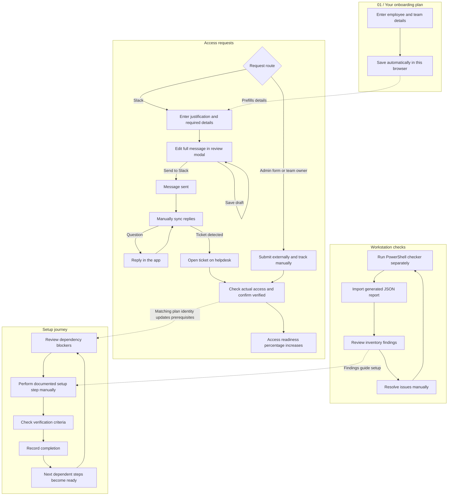

# Onboarding workspace flows

## 01 / Your onboarding plan

Enter name, work email, start date, EM, GitHub username and AWS group → save automatically in this browser → use details in form/team drafts and prefill GitHub/AWS request details. The connected Slack account remains the requester. This form does not create an account or submit requests automatically.

## Access requests

Access readiness = verified permissions / all profile permissions. A linked Slack record takes precedence over its manual record. Sent messages and approved tickets are not counted as completed access.

Helpdesk route: Review request → enter justification/details → continue to full message review → edit any message text → save changes OR explicitly send to Slack → message sent → sync replies → answer questions in a styled reply dialog → sync again → detected ticket link → open helpdesk using your login → check actual access → confirm verification.

Admin rights: open required service-desk form → submit there → save ticket link and manually update status → verify actual access. Team-owned access: confirm owner → use draft → manually track status and verification.

No background polling or direct helpdesk ticket-status API is implemented. A network-uncertain send cannot be blindly resent. Backend requests retain the connected account and one entitlement key even when message wording is edited.

## Workstation checks

Run the PowerShell readiness checker separately → inspect local inventory → generate JSON report → import report → review ready/missing/blocked/unverified results → resolve findings → rerun and import a fresh report. Import does not grant access or complete setup steps.

## Setup journey

Review prerequisites and dependency blockers → verify required access → manually perform the documented step → check its verification criteria → record completion → next dependent steps become ready. Removing a prerequisite invalidates downstream recorded completion. Nothing on this page runs setup.bat or installs dependencies.

Slack verification updates the saved plan/setup prerequisites only when the configured connected-account email matches the plan email. Other records remain isolated.

