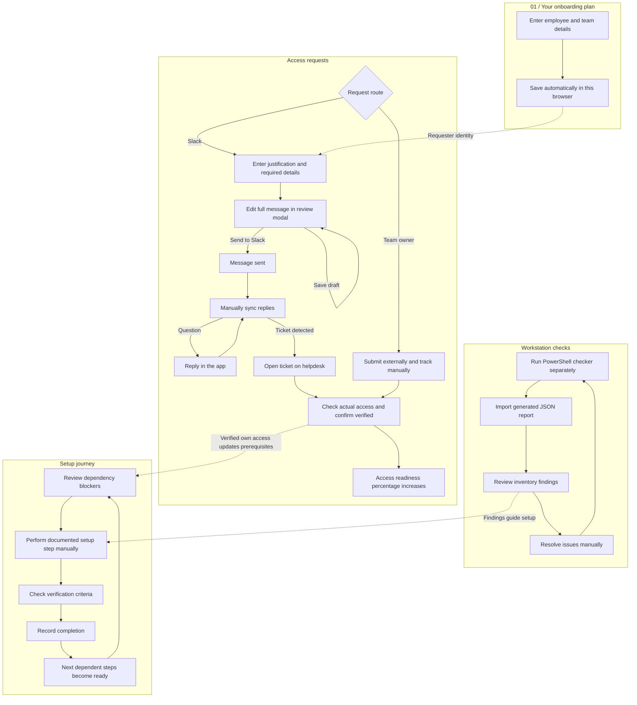

# Onboarding workspace flows

## Requester identity

The initial onboarding form is temporarily removed while role-based dashboards are developed. The connected Slack account is the requester. GitHub username and AWS group are entered within each request dialog.

## Access requests

Access readiness = verified permissions / all profile permissions. A linked Slack record takes precedence over its manual record. Sent messages and approved tickets are not counted as completed access.

Helpdesk route: Review request → enter justification/details → continue to full message review → edit any message text → save changes OR explicitly send to Slack → message sent → sync replies → answer questions in a styled reply dialog → sync again → detected ticket link → open helpdesk using your login → check actual access → confirm verification.

Admin rights follow the same Slack review/edit/send/sync/verify flow. Team-owned access: contact the EM or owner → manually track status and verification.

No background polling or direct helpdesk ticket-status API is implemented. A network-uncertain send cannot be blindly resent. Backend requests retain the connected account and one entitlement key even when message wording is edited.

## Workstation checks

Run the PowerShell readiness checker separately → inspect local inventory → generate JSON report → import report → review ready/missing/blocked/unverified results → resolve findings → rerun and import a fresh report. Import does not grant access or complete setup steps.

## Setup journey

Review prerequisites and dependency blockers → verify required access → manually perform the documented step → check its verification criteria → record completion → next dependent steps become ready. Removing a prerequisite invalidates downstream recorded completion. Nothing on this page runs setup.bat or installs dependencies.

Explicit verification of the connected requester’s own Slack records updates local setup prerequisites. Role-based hire/account mapping remains pending.

